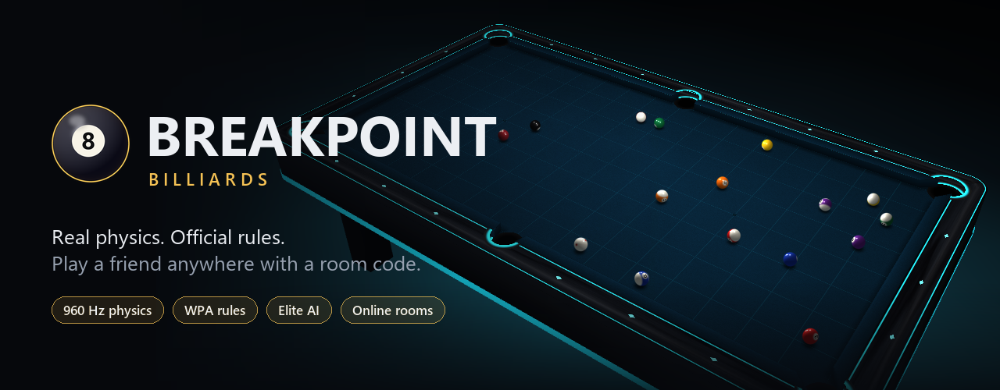
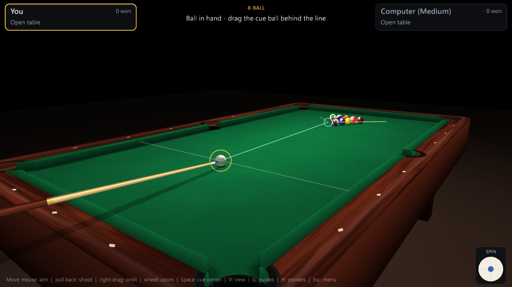
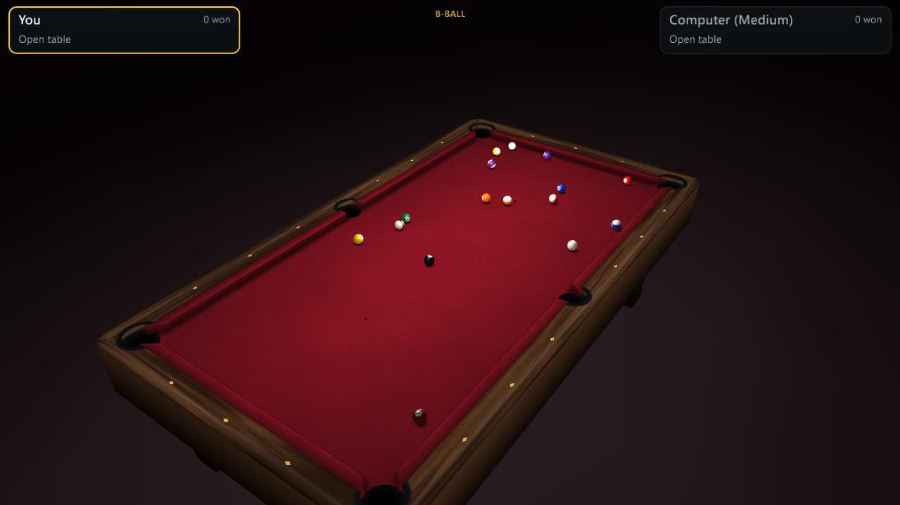
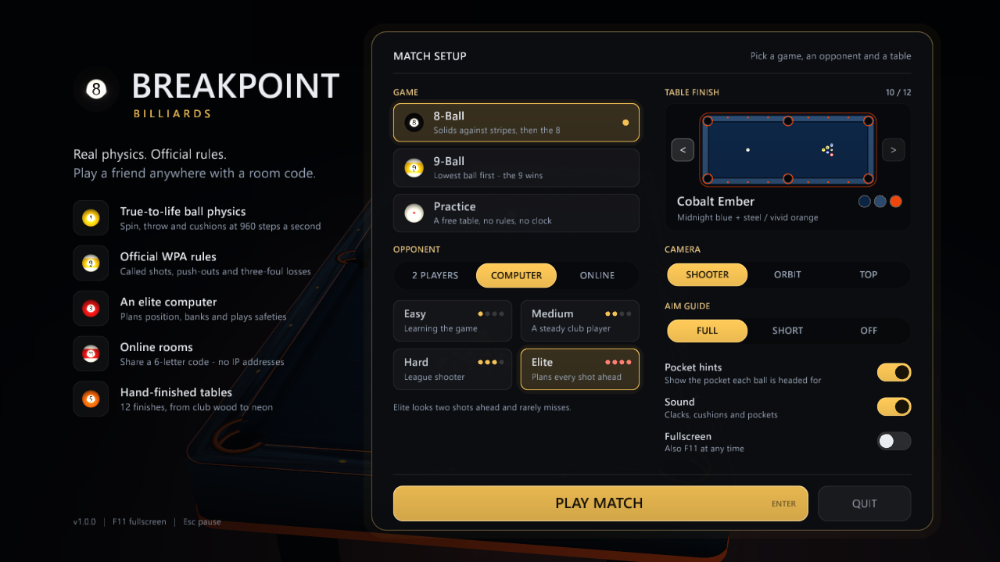
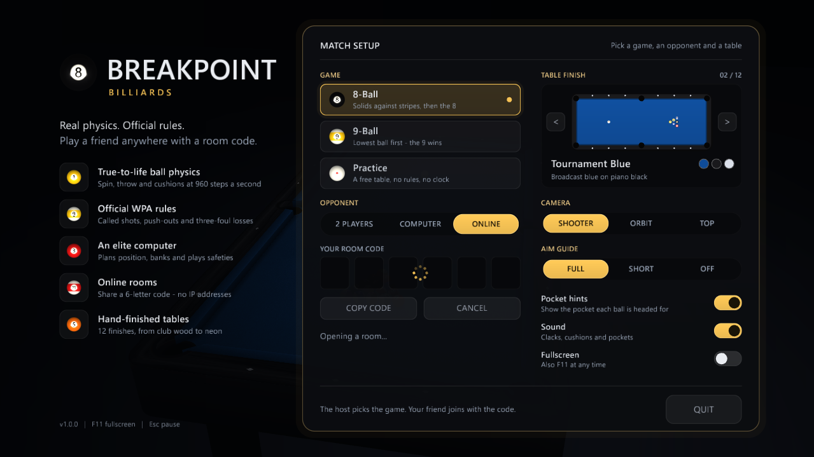
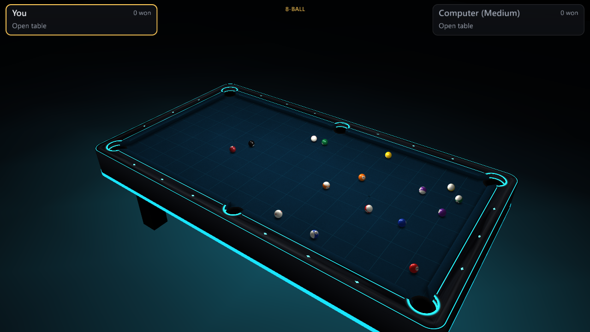
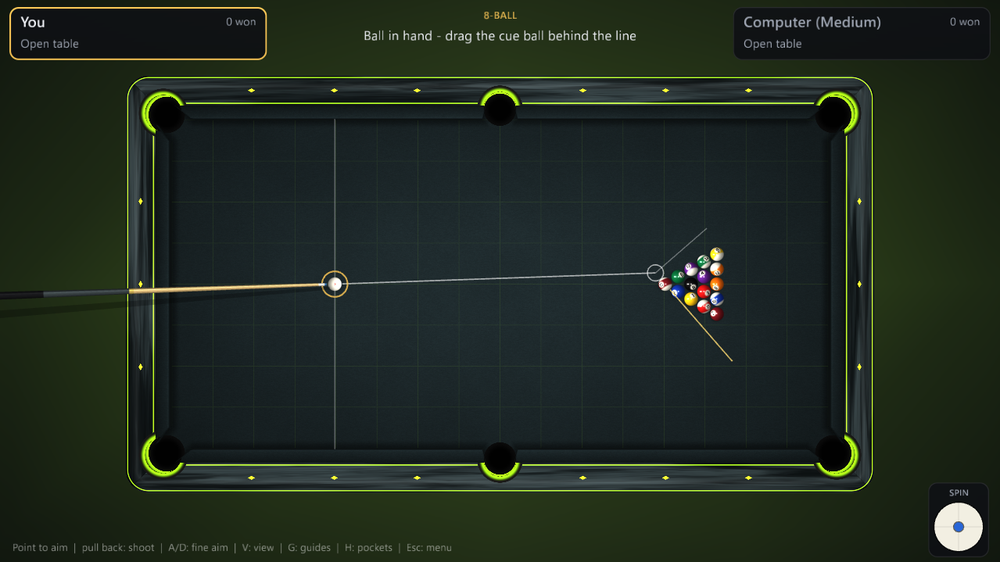

<div align="center">



# Breakpoint Billiards

**A realistic 3D pool game for Windows.** Real ball physics, the official WPA rulebook,<br>
a computer opponent that plans ahead, and online matches you join with a 6-letter room code.

[](https://github.com/nissi15/breakpoint-billiards/releases/latest)
[](https://github.com/nissi15/breakpoint-billiards/actions/workflows/ci.yml)
[](#install)
[](https://www.rust-lang.org)
[](LICENSE)

[**Download**](#install) &nbsp;&middot;&nbsp; [**Play online**](#play-a-friend-online) &nbsp;&middot;&nbsp; [**Controls**](#controls) &nbsp;&middot;&nbsp; [**Build from source**](#build-from-source)

</div>

---

## Why you'll like it

<table>
<tr>
<td width="33%" valign="top">

### 🎱 Physics that feels right
Balls slide, roll and spin like the real thing. Follow, draw, side spin, throw and cushion rebound are all simulated at **960 steps a second**, at real speed: never slow motion, whatever your frame rate.

</td>
<td width="33%" valign="top">

### 📜 Official rules, refereed
**8-Ball** and **9-Ball** follow the **WPA Rules of Play**: called shots, safeties, ball in hand, illegal breaks, push-outs, three-foul losses and stalemates. You just play.

</td>
<td width="33%" valign="top">

### 🧠 A computer that thinks
Four levels from *Easy* to *Elite*. The computer plays out every candidate shot in the real physics, looks for banks and combinations, plays position and hides the cue ball when it has no shot.

</td>
</tr>
<tr>
<td valign="top">

### 🌍 Online with a room code
Click **Create room**, send your friend the code, they type it in. No IP addresses, no port forwarding, no accounts. On the same Wi-Fi the game connects directly for the lowest delay.

</td>
<td valign="top">

### 🎨 Twelve table finishes
From club mahogany and tournament blue to neon-lit futuristic tables, each with its own cloth, rails and accent colour. Your pick is remembered.

</td>
<td valign="top">

### 🎥 A camera that follows you
Aim from behind the cue, then the view lifts to watch the shot and drops back for your next one. Orbit, zoom or switch to a top view whenever you like.

</td>
</tr>
</table>

## Screenshots

<table>
<tr>
<td width="50%"><br><sub><b>Shooter view.</b> The cue, the aiming line and where the object ball will go.</sub></td>
<td width="50%"><br><sub><b>The break.</b> Fifteen balls, every collision simulated.</sub></td>
</tr>
<tr>
<td><br><sub><b>Match setup.</b> Game, opponent, table, camera and aim assist in one place.</sub></td>
<td><br><sub><b>Online rooms.</b> Share the code, and the match starts when your friend joins.</sub></td>
</tr>
<tr>
<td><br><sub><b>Neon Grid.</b> One of the futuristic finishes.</sub></td>
<td><br><sub><b>Top view.</b> Plan the whole table at a glance.</sub></td>
</tr>
</table>

## Install

### Option 1: download (recommended)

1. Open the [**latest release**](https://github.com/nissi15/breakpoint-billiards/releases/latest).
2. Download **`BreakpointBilliards-x.y.z-Setup.exe`** and run it.<br>
   *Prefer no installer?* Download the **`.zip`**, extract it and double-click `breakpoint-billiards.exe`, or `install.cmd` to add Start menu and desktop shortcuts.

> Windows SmartScreen may say it "protected your PC" because the game isn't code-signed. Click **More info → Run anyway**.

### Option 2: clone and install

You need [Git](https://git-scm.com) and [Rust](https://rustup.rs).

```powershell
git clone https://github.com/nissi15/breakpoint-billiards.git
cd breakpoint-billiards
.\install.cmd
```

This builds the game, installs it to `%LOCALAPPDATA%\Programs\Breakpoint Billiards`, adds Start menu and desktop shortcuts, and lists it under **Settings → Apps** so it uninstalls like any other game.

**Uninstall:** Settings → Apps → *Breakpoint Billiards* → Uninstall, or run `uninstall.ps1`.

## Play a friend online

```
  YOU                                     YOUR FRIEND
  ───                                     ───────────
  Opponent: ONLINE                        Opponent: ONLINE
  [ CREATE ROOM ]                         types  K 7 Q X 2 M
        │                                 [ JOIN ROOM ]
        └──── "K7QX2M" ──── send it ─────────────┘
                     (text, DM, call...)
                 the match starts on both screens
```

- **The host picks the game** (8-Ball or 9-Ball); the guest joins with the code. Paste with **Ctrl+V**.
- **Same Wi-Fi?** The game finds the room on your network and connects directly.
- **Anywhere else?** Both players meet through a free public relay. Only shots travel over the internet, so it stays quick even on slow connections. The HUD shows the current delay, for example `ONLINE 84 ms`.
- Every important message is confirmed by the other player and re-sent if the relay drops it, so a match never stalls on a lost shot.
- Both computers run the same physics, and after every shot the shooter's final ball positions are shared, so the two tables can never drift apart.

> **Privacy:** the relay is public and messages aren't encrypted. They only contain shot data, never names or files, but don't use room codes for anything sensitive.

## Controls

| Action | Mouse / key |
|---|---|
| Aim | Move the mouse |
| Shoot | Hold **left button**, pull back for power, release |
| Fine aim | **A / D** or arrow keys (hold **Shift** for finer) |
| Spin (english) | Drag the dot on the cue-ball widget, bottom right; **C** resets |
| Look around | **Right-drag** to orbit, **wheel** to zoom, **middle-drag** to move |
| Camera angles | **1–8** presets, **V** next camera, **Space** side or centred cue view |
| Aim guide | **G** full / short / off, **H** pocket hints |
| Call a shot (8-Ball) | Click a pocket, right-click a ball; **S** calls safety |
| Push out (9-Ball) | **P** on the shot after the break |
| Place the cue ball | Drag it when you have ball in hand |
| Pause / fullscreen | **Esc** / **F11** |

<details>
<summary><b>Rules in brief</b></summary>

**8-Ball.** Pocket all of your group (solids 1–7 or stripes 9–15), then the 8. Every shot after the break must be called: obvious shots are called for you, otherwise click the pocket. Pocketing the 8 early, in an uncalled pocket, or on a foul loses the rack. An illegal break, or the 8 down on the break, gives the right player a choice of how to continue.

**9-Ball.** Always hit the lowest-numbered ball first. Any legally pocketed ball keeps you at the table, and the legal 9 wins. Straight after the break you may play a *push out*. Three fouls in a row lose the rack.

**Fouls.** Scratching, hitting the wrong ball first, or no ball reaching a rail after contact all give your opponent ball in hand.

</details>

## How it's built

Breakpoint Billiards is about 7,500 lines of Rust on top of [macroquad](https://github.com/not-fl3/macroquad). It's a single small executable with no game assets to download: the table, balls and sounds are all generated by code.

| Module | What it does |
|---|---|
| [`physics.rs`](src/physics.rs) | Fixed-step rigid-ball simulation: sliding and rolling friction, spin, ball-ball throw, cushion rebound with english, pockets. Deterministic, so the same shot always plays the same way. |
| [`rules.rs`](src/rules.rs) | The WPA referee for 8-Ball and 9-Ball, written as pure functions so the AI uses exactly the same judgement. |
| [`ai.rs`](src/ai.rs) | The computer opponent: generates shots, simulates each in the real physics, scores the result and the position it leaves. |
| [`net.rs`](src/net.rs) | Room codes, LAN discovery, direct TCP, and a tiny built-in MQTT client for the internet relay. |
| [`render.rs`](src/render.rs) | Shaders for the cloth, rails and balls, plus the 3D table and cue. |
| [`menu.rs`](src/menu.rs), [`main.rs`](src/main.rs) | Menus, camera, HUD, input and the game loop. |

## Build from source

```powershell
cargo run --release          # play
cargo test --release         # run the test suite
cargo test --release relay -- --ignored   # also test the internet relay (needs internet)
```

Releases are built by GitHub Actions: pushing a tag like `v1.0.1` tests the game, then publishes a release with the installer and the portable zip.

## System requirements

- Windows 10 or 11, 64-bit
- Any GPU with OpenGL 3 support (runs smoothly on Intel HD 620 integrated graphics)
- An internet connection for online play with friends on other networks

## License

[MIT](LICENSE). Made with care, and a lot of missed shots.
